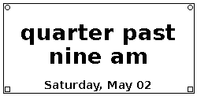

# Little Fuzzy Clock

[](https://github.com/gkoch02/LittleFuzzyClock/actions/workflows/test.yml)
[](https://github.com/gkoch02/LittleFuzzyClock/actions/workflows/github-code-scanning/codeql)
[](.github/workflows/test.yml)
[](https://www.raspberrypi.com)
[](LICENSE)

A fuzzy clock for a Raspberry Pi Zero driving a [Waveshare 2.13" e-ink display (V4)](https://www.waveshare.com/wiki/2.13inch_e-Paper_HAT_Manual).

Instead of showing an exact time, it displays natural-language phrases like "quarter past nine am" or "twenty to three pm", with the date as a footer and a decorative border in a style that suits the font (Bauhaus, rustic, sketchy, or retro).



## Hardware

A Raspberry Pi Zero (or any Pi with SPI), a Waveshare 2.13" e-Paper HAT V4 (122×250, black/white), and a push button between GPIO 3 (BCM, physical pin 5) and ground for manual refresh and shutdown. GPIO 3 doubles as the Pi's wake-from-halt pin, so the same button can also power the clock back on after a long-press shutdown.

It is run on Raspberry Pi OS Bookworm (Debian 12), whose system Python is 3.11; CI also runs on 3.12. `deploy.sh` targets Bookworm's PEP 668 model (system Python via `apt`, no `pip install`), and should work on both 32-bit and 64-bit Pi OS, though only 32-bit on a Pi Zero is regularly exercised. `waveshare_epd/` is vendored from [waveshare/e-Paper](https://github.com/waveshare/e-Paper) (`RaspberryPi_JetsonNano/python/lib/waveshare_epd/`), `epd2in13_V4.py` V1.0 dated 2023-06-25 and `epdconfig.py` V1.2. To resync, copy those two files plus `__init__.py` from upstream — don't edit them in place; ruff is configured to skip the directory in `pyproject.toml`.

## Behaviour

From sunrise to sunset, within 7 AM – 10:59 PM, the display updates every 5 minutes via partial refresh, black ink on white. From sunset to 10:59 PM the same clock face shows with the colours inverted, white on black, if after-hours mode is on (see [below](#after-hours-mode)). From 11 PM to 6:59 AM the panel shows "Goodnight" and sleeps.

A short button press (0.05–2 s) forces an immediate refresh (ignored during night mode, where the panel is asleep). A long press (≥ 5 s) shuts the Pi down via `sudo -n shutdown -h now`; the daemon runs as a regular user, so this relies on the NOPASSWD rule `deploy.sh` installs at `/etc/sudoers.d/fuzzyclock`.

Every call into the e-paper driver is bounded by a 10-second deadline, so a stuck BUSY pin (usually a loose ribbon cable) surfaces as a logged render failure instead of a silently frozen daemon. Repeated failures re-init the panel, and if that doesn't help the daemon exits so `systemd` restarts it.

## Rebuilding from scratch

Clone the repo anywhere on the Pi and run the deploy script. The systemd unit is templated at install time with the invoking user's home directory, so the clock works under any account — there's no need to run as `pi`:

```bash
git clone https://github.com/gkoch02/LittleFuzzyClock.git
cd LittleFuzzyClock
bash deploy.sh
```

The script installs dependencies via `apt` (Raspberry Pi OS Bookworm's PEP 668 blocks pip from touching the system Python), enables SPI, and installs and starts the `fuzzyclock.service` systemd unit.

> **Note:** If SPI wasn't already enabled, the script enables it for you, but you may need to reboot once before the display responds.

## Testing without hardware

`fuzzyclock_preview.py` supports a `--dry-run` mode that renders to a PNG instead of the display — useful for development on a non-Pi machine:

```bash
pip install -r requirements.txt   # only needed off-Pi; deploy.sh uses apt on-Pi
python3 fuzzyclock_preview.py --dry-run --output preview.png
```

Additional flags for previewing specific configurations:

```bash
# pin to a specific time (HH:MM)
python3 fuzzyclock_preview.py --dry-run --time 09:30 --output preview.png

# pick a dialect, font, and frame style
python3 fuzzyclock_preview.py --dry-run --dialect shakespeare --font literata --frame rustic --output preview.png
```

## Phrasing personalities

The dialects, each reading 9:30 so you can compare them:

| Dialect                | 9:30 reading                       | Character                                                          |
| ---------------------- | ---------------------------------- | ------------------------------------------------------------------ |
| `classic` (default)    | `half past / nine am`              | Plain English fuzzy time.                                          |
| `shakespeare`          | `'tis half past / nine of the clock` | Archaic English; drops AM/PM.                                    |
| `klingon`              | `half past / Hut rep`              | Real tlhIngan Hol numerals; "rep" is Klingon for *hour*.           |
| `belter`               | `half past / nine bell, ya`        | Lang Belta creole from *The Expanse*; nautical "bell" for time.    |
| `german`               | `halb / zehn`                      | Standard High German; "halb" anchors on the *next* hour.           |
| `hal`                  | `MIDPOINT / 0900 HOURS`            | HAL 9000 mission-control patter; 24h numeric for AM/PM clarity.    |
| `cthulhu`              | `the half-hour / the ninth hour`   | Lovecraftian dread; ordinal hours; climaxes with "the stars are right". |
| `latin`                | `media post / hora IX a.m.`        | Roman-numeral hours; real Latin prepositions.                      |

Pick one with `--dialect`:

```bash
python3 fuzzyclock_preview.py --dry-run --dialect shakespeare --output preview.png
```

The daemon reads the same setting from the `dialect:` field in `fuzzyclock_config.yaml` (next to the daemon). To change it on the Pi, edit that file and restart the service:

```yaml
dialect: shakespeare
```

Unknown values fall back to `classic` with a warning in the daemon log.

## Fonts

Open-source fonts across many styles (literary serifs, slab serifs, soft and rounded, geometric and condensed, bold display, retro and computing, vintage, deco and futuristic, blackletter and fantasy, handwriting and script, hand-drawn, textured and experimental, horror and macabre, and the plain odd) are vendored in `fonts/`, and a few commercial fonts unlock when a licensed file is dropped into the same folder. See **[docs/fonts.md](docs/fonts.md)** for previews and the full list.

Pick one with `--font`:

```bash
python3 fuzzyclock_preview.py --dry-run --font roboto-slab --output preview.png
```

The daemon reads the same setting from the `font:` field in `fuzzyclock_config.yaml`:

```yaml
font: roboto-slab
```

Set `font: random` to roll a new vendored variant every time the time phrase changes — see [docs/fonts.md](docs/fonts.md#random-mode).

Unknown values fall back to `dejavu` with a warning in the daemon log.

## Border frame styles

Each border style is paired by default with a matching font category:

| Style      | Character                                                          |
| ---------- | ------------------------------------------------------------------ |
| `bauhaus`  | Plain geometric corners — the default for most sans/serif fonts    |
| `rustic`   | Double rule with diamond corners — pairs with blackletter and horror fonts |
| `sketchy`  | Loose, uneven lines — pairs with hand-drawn and script fonts       |
| `retro`    | Stair-stepped pixel border — pairs with pixel, deco, and techno fonts |

The default `auto` setting picks the frame that best complements the active font. You can override it for any font with `--frame`:

```bash
python3 fuzzyclock_preview.py --dry-run --font dejavu --frame retro --output preview.png
```

The daemon reads the same setting from the `frame:` field in `fuzzyclock_config.yaml`:

```yaml
frame: auto   # auto, bauhaus, rustic, sketchy, or retro
```

Unknown values fall back to `auto` with a warning in the daemon log.

## After-hours mode

After dark, the clock flips to white-on-black so it doesn't glare at you across the room. The daemon computes local sunrise and sunset itself (no network calls) using the coordinates in `fuzzyclock_config.yaml` (the same file that holds `dialect:` and `font:`):

```yaml
latitude: 51.4769
longitude: 0.0005
```

Edit those two numbers to match your location and restart the service. Leave them out (or set both to `null`) to disable after-hours mode and keep the plain day/night behaviour. If the file is missing or malformed, after-hours mode stays off too — as it does for a value that isn't a number, or one outside the real ranges (latitude −90…90, longitude −180…180). A bad coordinate logs a warning and disables after-hours rather than taking the daemon down, so a typo here can't leave the clock stuck in a restart loop.

The schedule becomes: normal clock from sunrise (or wake-up at 7 AM, whichever is later) to sunset, inverted clock from sunset to bedtime at 11 PM, then "Goodnight" until 7 AM. Mode transitions are checked every minute, so the swap happens within a minute of the sun crossing the horizon.

Sunrise/sunset are computed via NOAA's simplified solar-position equation, accurate to roughly a minute outside polar regions. At extreme latitudes where the sun never rises or never sets on a given day, the daemon stays in normal day mode.

## Tests

The suite in `tests/` covers the time-phrasing logic across every dialect, the sunrise/sunset approximation, the daemon's mode, config and retry logic, the `--dry-run` path, a render smoke test for the clock face and its frames, and a check that importing the daemon loads no fonts and reads no config. Run it from the repo root:

```bash
python3 -m unittest discover

# a single file
python3 -m unittest tests.test_fuzzy_time
```

The same suite runs in CI on every push and pull request — see `.github/workflows/test.yml`. The repo's layout is described in [`CLAUDE.md`](CLAUDE.md).

## License

This repository is MIT licensed; see [`LICENSE`](LICENSE). The grant covers
everything here except the vendored third-party material, which keeps its own
terms: the Waveshare driver in `waveshare_epd/` (MIT, © Waveshare) and every
typeface in `fonts/` (mostly SIL Open Font License 1.1, some Apache 2.0, plus
two exceptions). See [`THIRD_PARTY_NOTICES.md`](THIRD_PARTY_NOTICES.md) for the
details and for the known font-licensing gap.
